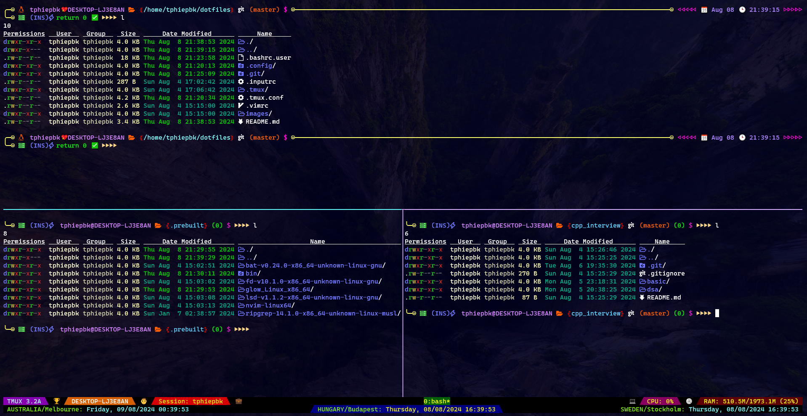
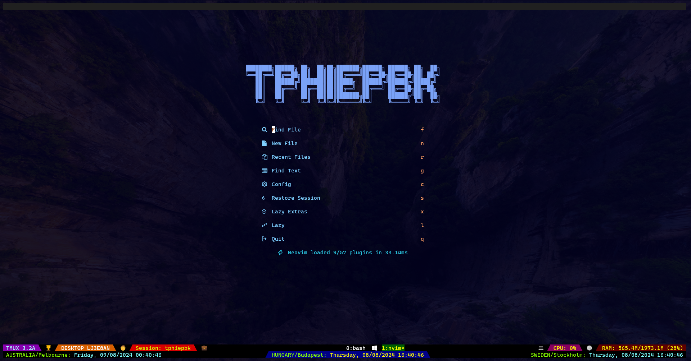
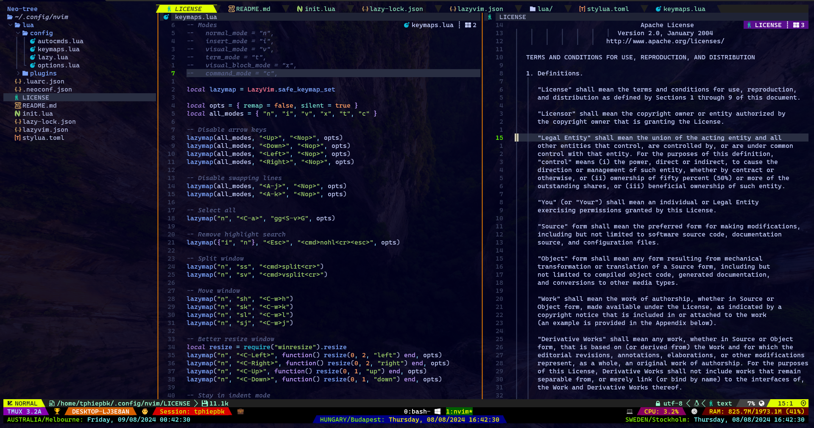
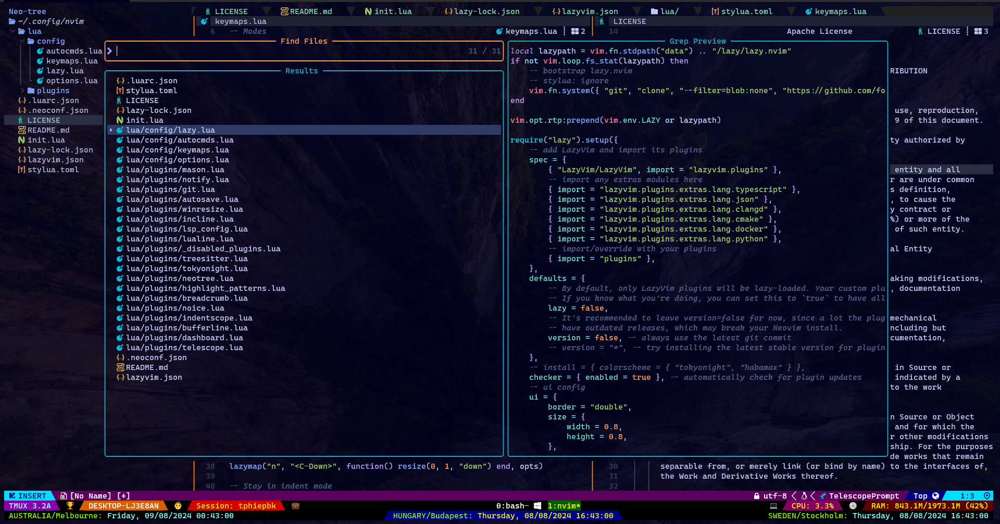

# TPHIEPBK'S CONFIGURATION

## OS

+ Windows Subsystem for Linux (WSL)
+ Distro: openSUSE-Tumbleweed
+ RAM: 8GB
+ WSL configuration file on Windows: `C:\Users\tphiepbk\.wslconfig`
```
[wsl2]
processors=4
memory=8589934592
swap=2147483648
nestedVirtualization=true
```

+ WSL configuration file on the distro (Ubuntu): `/etc/wsl.conf`
```
[boot]
systemd=true

[interop]
appendWindowsPath=false
```

## Prerequisites

***zypper packages***

```
sudo zypper install python313 \
    neovim \
    eza \
    bat \
    fzf \
    ripgrep \
    fd \
    glow \
    xclip \
    gcc16 \
    gcc16-c++ \
    git \
    python313-virtualenvwrapper \
    docker \
    tmux \
    fzf-tmux \
    bc \
    lazygit \
    gcc \
    gcc-c++ \
    make \
    htop \
    python313-csvkit \
    file \
    ShellCheck \
    stress-ng \
    lsb-release \
    kvm_server \
    kvm_tools \
    libvirt-daemon \
    libvirt-daemon-driver-nwfilter \
    bridge-utils \
    virt-viewer \
    libguestfs \
    kernel-default \
    gdb \
    k3s-install \
    ImageMagick \
    python313-pip \
    python313-neovim \
    libevent-devel \
    ncurses-devel \
    bison \
    docker-compose \
    aws-cli \
    jq \
    cmake \
    rust \
    lua51
```

***nodejs***

+ https://nodejs.org/en/download/package-manager
+ Use "nvm" to install

***npm packages***

`npm install -g neovim@latest tree-sitter-cli@latest`

***docker***
+ https://docs.docker.com/engine/install/ubuntu/#install-using-the-repository
+ Add current user to *docker* group: `sudo usermod -a -G docker tphiepbk`

## Neovim (version 0.12.5)

Use ***lazyvim*** - http://www.lazyvim.org/ for all configurations.

***Directory*** structure

/home/tphiepbk/.config/nvim</br>
├── lazy-lock.json</br>
├── lazyvim.json</br>
├── init.lua</br>
└── lua</br>
    ├── config</br>
    │   ├── lazy.lua</br>
    │   ├── options.lua</br>
    │   ├── autocmds.lua</br>
    │   └── keymaps.lua</br>
    └── plugins</br>
        ├── flash_disabled.lua</br>
        ├── colorscheme.lua</br>
        ├── noice.lua</br>
        ├── bufferline.lua</br>
        ├── highlight_patterns.lua</br>
        ├── incline.lua</br>
        ├── breadcrumb.lua</br>
        ├── neotree.lua</br>
        ├── lsp_config.lua</br>
        ├── snacks.lua</br>
        ├── winresize.lua</br>
        ├── lualine.lua</br>
        └── autosave.lua</br>

## Keymaps

Leader key: `<Space>`

| Key 1     | Key 2   | Key 3 | Action                    |
|:---------:|:-------:|:----:|:--------------------------:|
| `<Space>`   | `<Space>` |      | Telescope find files       |
| `<Space>`   | `f`       |  `f`   | Telescope find files       |
| `<Space>`   | `f`       |  `g`   | Telescope live grep        |
| `<Space>`   | `f`       |  `b`   | Telescope find buffers     |
| `Tab`       |         |      | Next tab                   |
| `Shift`     | `Tab`     |      | Previous tab               |
| `s`         | `s`       |      | Split windows horizontally |
| `s`         | `v`       |      | Split windows vertically   |
| `<Space>`   | `e`       |      | Toggle NeoTree             |
| `<Space>`   | `q`       | `q`    | Quit                       |
| `<Space>`   | `q`       | `a`    | Quit all                   |
| `<Space>`   | `w`       | `q`    | Save and quit              |

## Screenshots

Visit http://patorjk.com/software/taag to get cool string like this.









## Inspired by: https://github.com/craftzdog/dotfiles-public
## Many thanks to all developers, appreciate it :D
